# Project 6 - CI

## Project Description & Diagram

**Goal of Project**
The goal of the project is to automate the building, semantic versioning and pushing of our docker application/image. Doing so by configuring a continuous integration pipeline where any code commited with a 
semantic version tag is automatically built into a Docker image and pushed to our remote docker repo.

**Tools used in project**
- WSL2: Local linux environment used to write the execute project commands.
- Git : Version control system to track code changes, and commit updates
- GitHub: remote repo host that stores our code
- GitHub Actions: The CI/CD automation pipeline that allows for execution of workflow steps automatically.
- Docker Hub : remote container host that receives and stores the final built images.

**Diagram of Project** 

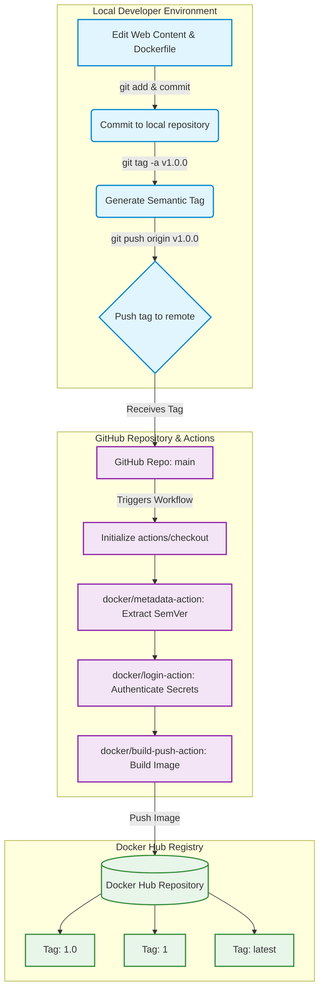

## Part 1

**Dockerfile**

The [Dockerfile](./web-content/Dockerfile) included in our [web-content](./web-content) folder is the instruction to building our docker image. 
The instructions include `FROM httpd:2.4` which sets the base image of our own image as version 2.4 of the Apache HTTP Server.
Next is `COPY . /usr/local/apache2/htdocs/` which copies all files in the same directory as the Dockerfile to the default web directory.

**Build image**

To build an image using the Dockerfile, you will need to run a docker build command. In my own case I ran `docker build -t project6:1.0.0 .`. 
`-t` allows for naming of the image so it can be easily recognizable later. Then we name the image in my case I used `project6`, followed by `:1.0.0` for version control

**Run container**

To then run a container that will serve our web app from the image we built, we will need to run a docker run command. In my case, it was ` docker run -d -p 8080:80 --name project6 loosegoose38/project6:1.0.0`
`-d` runs the container in the background.
`-p 8080:80` connects our pc to the container, so 8080 is what we use on our web browser and 80 is the internal port the Apache web server is listening to.
`--name project` assigns the name to the container
`loosegoose38/projects6:1.0.0` is the image used to build the container.

## Part 2

### Configure GitHub Repo Secrets
1. To begin, you will need to create a Personal Access Token with the correct permission for the scope of the project.
   1. Login into your DockerHub account and head to your account settings
   2. In the left bar, you will see "Personal Access Tokens". Click into it and "Generate new token".
   3. In the "Access token description" use a name that point to its uses, for example mine was named after this project.
   4. Expiration date, I chose 30 days since I only need it for this semester.
   5. Access Permissions should be set to Repo Read and Write, as we will be pushing out new images to Docker Hub so that requires write and read since we are using it for an action.
   6. Click "Generate" and save the token as it cannot be access again.

2. You will then need to set up your repo secrets with the newly generate token.
   1. Login into GitHub and navigate to the target repo.
   2. In the top repo nav bar, you should see your typical options like "Code" and "Issues", at the end click "Settings".
   3. From here click on "Secrets and variables" and then "Actions".
   4. Click "New repository secret" and enter a name for your docker username secret like "DOCKER_USERNAME", then paste your username in the "Secret" field and click "Add secret".
   5. repeat Step 4 for your docker token that you created, naming it like DOCKER_TOKEN.
   

3. The secrets set for this project will be used to authorize our docker workflow.

## CI with GitHub Actions
**Explanation of Workflow Trigger:** The workflow is configured with `on: push: brances: - main`. This means that the actions will be triggered when new commits are pushed to the main branch of our repo or pull request are merged into main.

**Explanation of Workflow Steps:**
- Check out the repo with `actions/checkout`, the GitHub Actions runner starts as a blank virtual machine, then this step clones the repo into that environment so the Docker engine has access to our Dockerfile and code.
- Set up Docker Buildx with `docker/setup-buildx-action`, initializes Docker's build engine which is required for building multi-architecture images and using cache layers.
- Login in to Docker Hub with `docker/login-action`, authenticates runner with our Docker Hub account securely using the repo secrets we used.
- Build and push with `docker/build-push-action`, executes the build process using the current directory as root, once the image is built the `push: true` tells the action to upload to our Docker Hub repo.

**Updating Values for Different Repos:**
- The image name would need to be changed depending on the project 
- The secrets would need to be added in the new repo as they are repo specific.

[Workflow file](https://github.com/WSU-kduncan/ceg3120-cicd-Cendejas2-f26/blob/22adf5fecc3a0752ade27f1a6dc35382bee32904/.github/workflows/docker-workflow.yml)

## Testing and Validating
To confirm that the CI pipeline executed successfully navigate to the "Actions" tab in your GitHub Repo, where you can ensure that your workflow has green checkmarks on every step.
As well navigate to your Docker Hub repo in the web browser where you can see that your latest tag shows it has just been updated.

**Verify image**
1. open terminal for me that will be a wsl environment.
2. pull the image using `docker pull loosegoose38/project6:latest`
3. start a new container using our pulled image using the command `docker run -d -p 8080:80 loosegoose38/project6:latest`
4. Since this is for a web app, navigate to the page on your web browser to ensure it up and running.

[Link to Docker Repo](https://hub.docker.com/repository/docker/loosegoose38/project6/general)

## Part 3

### Generating Tags
**See tags in git repo:** To see the tags in a git repo, simply run `git tag` in your terminal and a list of all existing tags will print out.

**Generate tags in git repo:** To generate tags in a git repo, ensure you have a git commit lined up and ready to be pushed. then use the command `git tag -a v1.0.0 -m "Release version v1.0.0"`, modifying it to fit your current version.

**Push tags to remote git repo:** To push the tags to git repo, you will need to run the specific command `git push origin v1.0.0` modifying to your specific version in order to push it to the remote server. The command `git push --tags` pushes all tags a once.

### Semantic Versioning Container Images with GitHub Actions
**Explanation of Workflow trigger:** The new workflow is configured with `on: push: tags: - 'v*.*.*'`. This ensures that the only executes when a git tag matching the semantic versioning format is pushed to the repo. therefore it ignores all other standard commits and pull requests

**Explanation of Workflow steps:** 
- Docker metadata with `docker/metadata-action`, which extracts version number from the git tag and auto formats the required output tags.
- The rest are the same as previous

**Values to update for different repo:**
- Changing the image to match the new docker hub repo in the metadata-action section.
- Manually add the GitHub Secrets to the new repo.

[Workflow File](https://github.com/WSU-kduncan/ceg3120-cicd-Cendejas2-f26/blob/f15dc5edda79446c90debe75dc5863dff89bedf0/.github/workflows/docker-workflow.yml)

### Testing & Validating
**Test workflow did tasking:** To check if it was successful, navigate to the actions tab in your GitHub repo. A new workflow should have been triggered with the tag name and completed successfully with all green checkmarks.
Navigate to your Docker Hub repo and check the tags to confirm that the latest, major, and minor tags were generated and pushed.

**Verify Image**
1. open terminal for me that will be a wsl environment.
2. pull the image using `docker pull loosegoose38/project6:1.0`
3. start a new container using our pulled image using the command `docker run -d -p 8080:80 loosegoose38/project6:1.0`
4. Since this is for a web app, navigate to the page on your web browser to ensure it up and running.

[Docker Hub](https://hub.docker.com/repository/docker/loosegoose38/project6/general)

## Testing and Proof

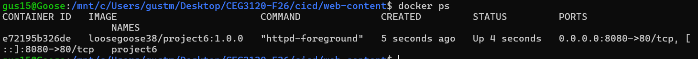
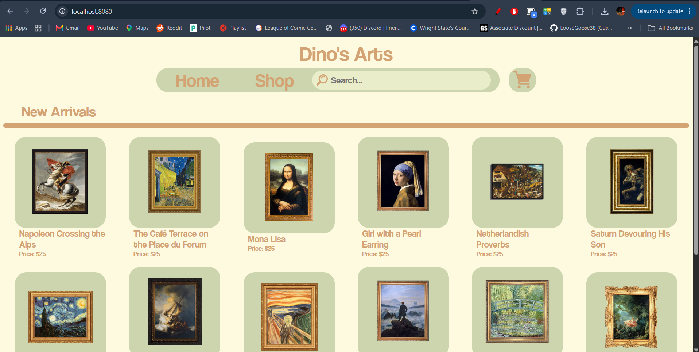
> The first screenshot shows our project 6 container containing our web-content is running. The second screenshot shows our html and css running on chrome, confirming that apache is serving our content.

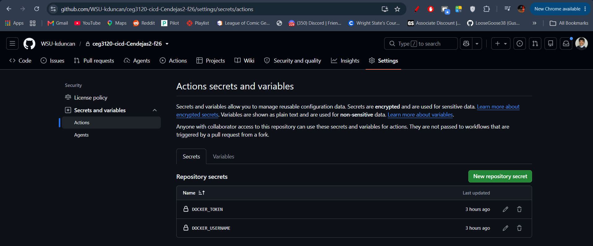
> This shows that the repo is configured with our Docker username and PAT to be used in our workflow.

> Shows that our workflow file successfully executed

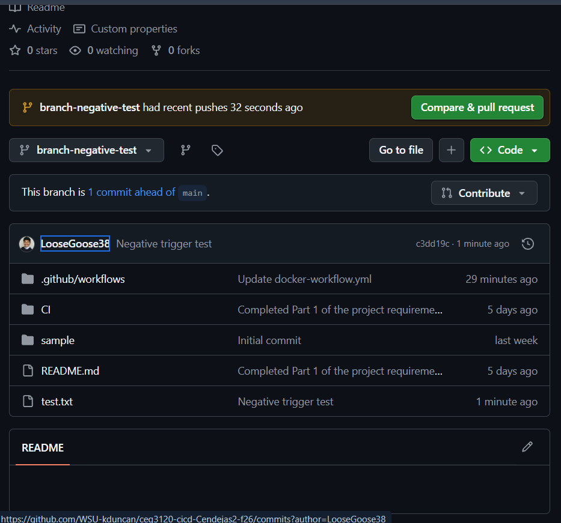
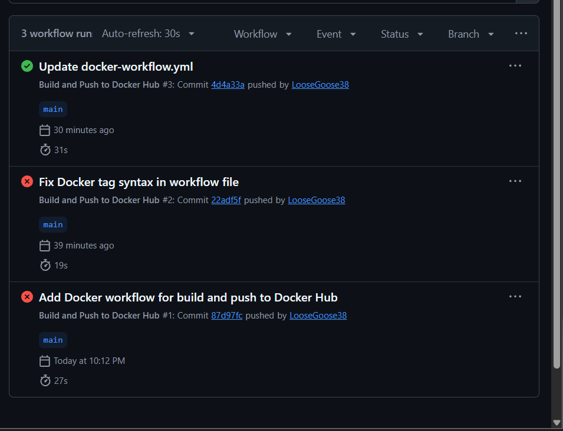
> Captures a successful negative test where the workflow trigger is restricted to the main branch.

> Captures a visible text change update on my site running on my container.

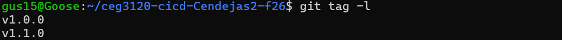
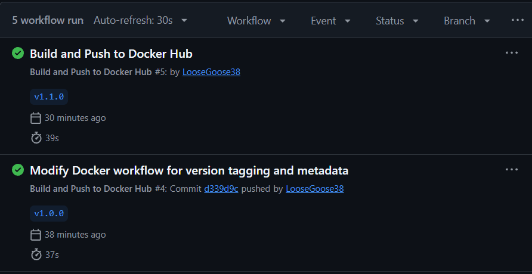
> Captures our the list of tags we have used and that they were successfully attached to our workflow event.

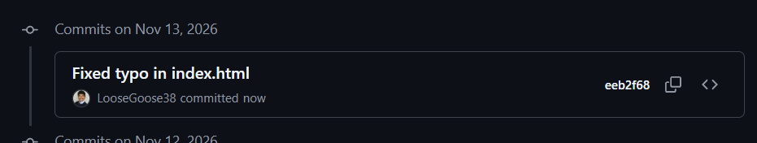
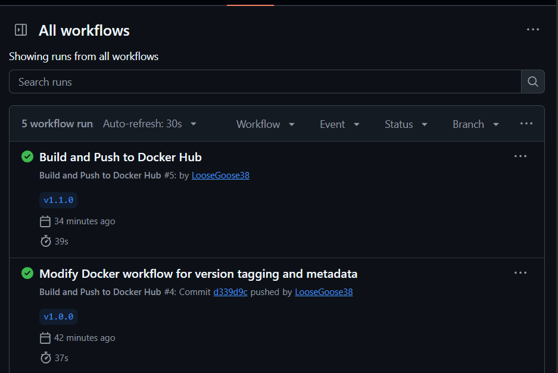
> This shows that when not adding a tag to my commit, a workflow was not triggered.

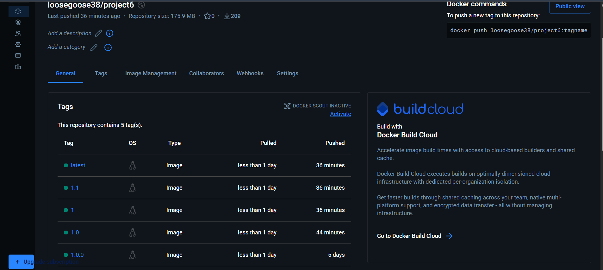
> This shows my docker repo with the latest, major, and minor tags.

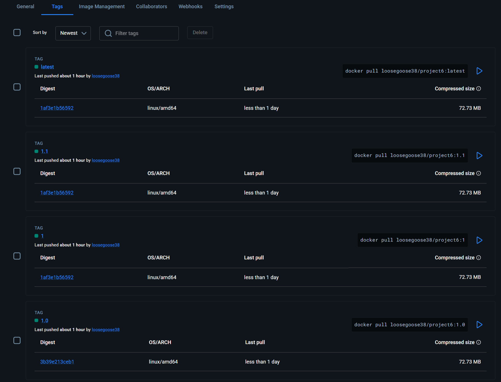
> Shows that the latest, 1, 1.1 all have the same Digest ID.

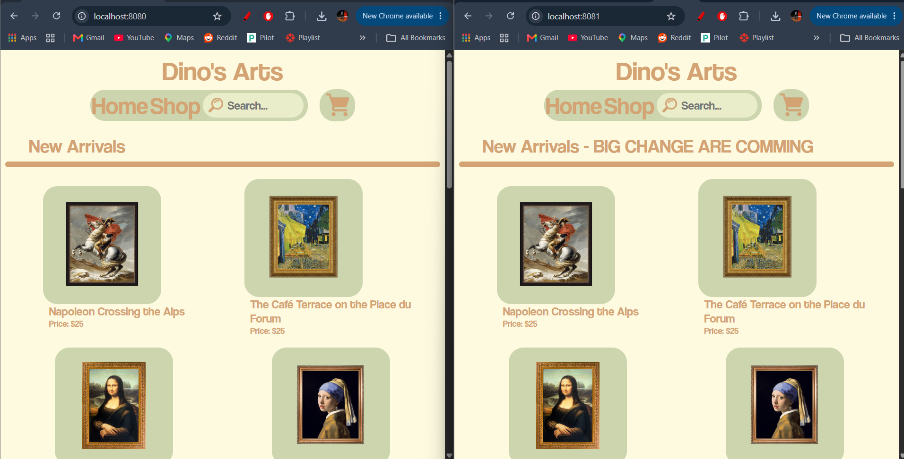
> This captures my container running on two different ports 8080 and 8081, the difference is one being my latest tagged image and the other being a rollback to previous one.

## Commits, Sources, and AI
- Gemini AI was used in the process of configuring the mermaid diagram for display within markdown.
- https://github.com/docker/build-push-action - Reference for yml syntax
- https://mermaid.js.org/ - reference for the Markdown diagram syntax used for my diagram.
- Google for general questions.

